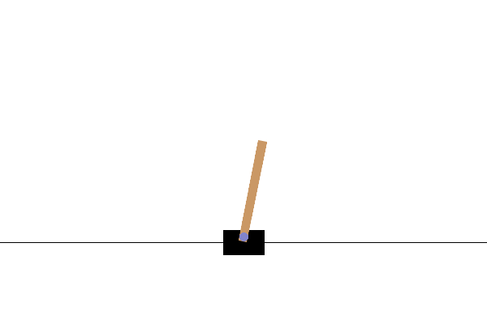
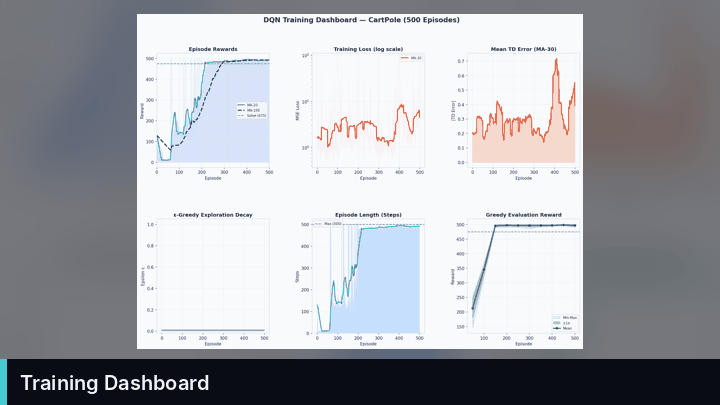
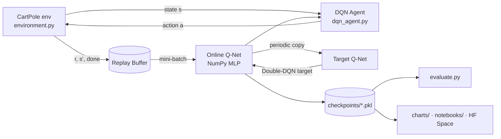

<div align="center">



<sub>CartPole task the agent learns to balance. Environment animation: <a href='https://github.com/Farama-Foundation/Gymnasium'>Farama Gymnasium</a> (MIT)</sub>

# 🎯 DQN CartPole — NumPy From Scratch

### A Double-DQN agent built from first principles in pure NumPy — no PyTorch, no TensorFlow

     

[](LICENSE)    

[](https://codespaces.new/shiroonigami23-ui/dqn-rl-project?quickstart=1) [](https://github.com/shiroonigami23-ui/dqn-rl-project/archive/refs/heads/main.zip)

[**🚀 Live Demo**](https://huggingface.co/spaces/ShiroOnigami23/dqn-cartpole-live) · [**Overview**](#-overview) · [**Features**](#-features) · [**Architecture**](#-architecture) · [**Getting Started**](#-getting-started) · [**Roadmap**](#-roadmap)

</div>

---

## 📸 Preview

<p align="center"></p>

## 📖 Overview

This project implements **every piece of a Deep Q-Network by hand** — the CartPole physics environment, the neural network
(forward pass, back-propagation, optimiser), the experience-replay buffer and the Double-DQN training loop — using only **NumPy**.
It is meant both as a learning resource ("what actually happens inside DQN?") and as a fully reproducible mini research project,
complete with 12 analysis charts, executable notebooks, a technical PDF, a Hugging Face Space and a GitHub Pages showcase.

**Latest run:** `python train.py --episodes 120` → evaluation mean reward **210.1 ± 30.6** over 20 episodes.

### ✨ Highlights

- **Zero deep-learning frameworks** — gradients are derived and coded manually
- **Double DQN** with target network and experience replay
- **Live demo** on [Hugging Face Spaces](https://huggingface.co/spaces/ShiroOnigami23/dqn-cartpole-live) and a [model card](https://huggingface.co/ShiroOnigami23/dqn-cartpole-numpy)
- **12 publication-style charts** — training dashboard, policy map, Q-value heatmap, algorithm comparison and more
- **Showcase site** — [GitHub Pages](https://shiroonigami23-ui.github.io/dqn-rl-project/) (`index.html` + D3.js)

## 🧩 Features

| Feature | What it does |
|---|---|
| **Custom environment** | `model/environment.py` re-implements CartPole dynamics so the project has no Gym dependency |
| **NumPy neural network** | `model/neural_network.py` — dense layers, ReLU, MSE loss, manual backprop and Adam |
| **Replay buffer** | `model/replay_buffer.py` — circular buffer with uniform mini-batch sampling |
| **Double-DQN agent** | `model/dqn_agent.py` — ε-greedy policy, online/target networks, periodic target sync |
| **Pre-training** | `pretrain.py` imitates a hand-crafted expert policy (behavioural cloning) to warm-start the Q-network before RL fine-tuning |
| **Checkpointing** | Snapshots every 50 episodes plus `best_model.pkl` and `final_model.pkl` with JSON metadata |
| **Chart generator** | `scripts/generate_all_charts.py` renders the 12-chart analysis suite into `charts/` |
| **Notebooks** | QuickStart, full analysis, evaluation and Kaggle run-all notebooks |
| **Web showcase** | `index.html` + `server.js` (Express + D3) animated presentation of the project |

## 🛠 Tech Stack

| Layer | Technology |
|---|---|
| Core ML | Python 3.11, NumPy |
| Visualisation | Matplotlib, D3.js |
| Notebooks | Jupyter, Kaggle kernels |
| Deployment | Hugging Face Space (`hf_space/app.py`), GitHub Pages |
| Showcase server | Node.js + Express |
| Extras | Unity CartPole scene (`unity_cartpole/`) |

## 🏗 Architecture

The agent, environment, network and buffer are independent modules wired together by `train.py`.



➡️ Full design notes, data flow and design decisions: **[docs/ARCHITECTURE.md](docs/ARCHITECTURE.md)**

## 📁 Project Structure

```text
dqn-rl-project/
├── model/              # environment, neural_network, replay_buffer, dqn_agent
├── train.py            # training entry point
├── pretrain.py         # supervised warm-start
├── evaluate.py         # evaluate a checkpoint
├── plot_results.py     # quick plots from logs
├── scripts/            # generate_all_charts.py, generate_pdf.py
├── checkpoints/        # *.pkl weights + *.json metadata
├── charts/             # 12 analysis figures
├── notebooks/          # QuickStart / Analysis / Evaluation / Kaggle
├── hf_space/           # Hugging Face Space app
├── kaggle_kernel/      # Kaggle kernel + metadata
├── unity_cartpole/     # Unity visualisation scene
├── docs/               # SHOWCASE, PUBLISHING, technical PDF
├── index.html          # GitHub Pages showcase
└── server.js           # local showcase server
```

## 🚀 Getting Started

### Prerequisites

- Python 3.11+
- Node.js 18+ (only for the local showcase server)

### 1. Get the code

Pick whichever method suits you:

| Method | Command |
|---|---|
| **HTTPS** | `git clone https://github.com/shiroonigami23-ui/dqn-rl-project.git` |
| **SSH** | `git clone git@github.com:shiroonigami23-ui/dqn-rl-project.git` |
| **GitHub CLI** | `gh repo clone shiroonigami23-ui/dqn-rl-project` |
| **ZIP** | [Download](https://github.com/shiroonigami23-ui/dqn-rl-project/archive/refs/heads/main.zip) and extract |
| **Codespaces** | [Open in browser](https://codespaces.new/shiroonigami23-ui/dqn-rl-project?quickstart=1) — zero local setup, dev container preconfigured |

> 🔑 **Using SSH for the first time?** Generate a key with `ssh-keygen -t ed25519 -C "you@example.com"`, add the `.pub` contents at **GitHub → Settings → SSH and GPG keys**, then test with `ssh -T git@github.com`.

### 2. Install & set up

```bash
cd dqn-rl-project
pip install numpy matplotlib jupyter
npm install            # optional: showcase server
```

### 3. Run

```bash
python train.py --episodes 120                              # train
python evaluate.py --model checkpoints/best_model.pkl       # evaluate
python scripts/generate_all_charts.py                       # regenerate the 12 charts
jupyter nbconvert --to notebook --inplace --execute notebooks/DQN_Complete.ipynb
npm start                                                   # showcase at http://localhost:3000
```

## 🎮 Usage

| Resource | Link |
|---|---|
| Live demo (HF Space) | https://huggingface.co/spaces/ShiroOnigami23/dqn-cartpole-live |
| Model card | https://huggingface.co/ShiroOnigami23/dqn-cartpole-numpy |
| Showcase site | https://shiroonigami23-ui.github.io/dqn-rl-project/ |
| Animations & diagrams | [docs/SHOWCASE.md](docs/SHOWCASE.md) |
| Publishing workflow | [docs/PUBLISHING.md](docs/PUBLISHING.md) |
| Technical write-up | [docs/technical_documentation.pdf](docs/technical_documentation.pdf) |

Folder-level guides live in each directory's own `README.md` (model, notebooks, scripts, charts, checkpoints, logs, docs).

## 🗺 Roadmap

**v1.0 — Core agent (done)**

- [x] NumPy MLP with manual backprop + Adam
- [x] Double DQN with target network & replay
- [x] 12-chart analysis suite, notebooks and technical PDF
- [x] Hugging Face Space, model card and GitHub Pages showcase

**v1.1 — Algorithmic upgrades**

- [ ] Dueling network head
- [ ] Prioritised Experience Replay (SumTree)
- [ ] n-step returns and a Huber-vs-MSE loss comparison
- [ ] Multi-seed evaluation with confidence intervals

**v1.2 — More environments**

- [ ] MountainCar and Acrobot ports of the custom environment
- [ ] Gymnasium adapter so the agent also runs on official envs
- [ ] Unit tests for gradients (finite-difference check) + GitHub Actions CI

**v2.0 — Teaching edition**

- [ ] Step-by-step "build DQN yourself" notebook series
- [ ] Interactive in-browser training (Pyodide) on the showcase page

➡️ Detailed plan, milestones and long-term vision: **[docs/ROADMAP.md](docs/ROADMAP.md)**

## 🤝 Contributing

Contributions, issues and feature requests are welcome!

1. Fork the repository
2. Create a feature branch: `git checkout -b feature/amazing-feature`
3. Commit your changes: `git commit -m "feat: add amazing feature"`
4. Push the branch: `git push origin feature/amazing-feature`
5. Open a Pull Request against `main`

Check the [issues page](https://github.com/shiroonigami23-ui/dqn-rl-project/issues) and the [roadmap](docs/ROADMAP.md) for ideas on where to help.

## 📜 Changelog

See [CHANGELOG.md](CHANGELOG.md) for the release history.

## 📄 License

Distributed under the **MIT** license. See [LICENSE](LICENSE) for details.

## 👤 Author

**Aryan Singh Chandel** (Shiro)

[](https://github.com/shiroonigami23-ui)

<div align="center">

⭐ **If you find this project useful, consider giving it a star!** ⭐

</div>
