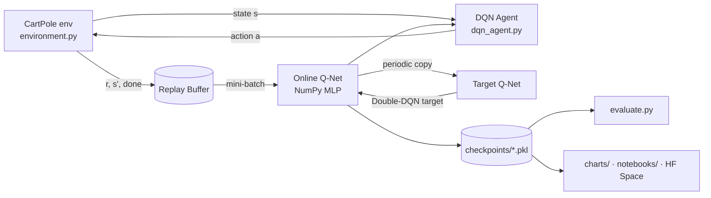

# 🏗 Architecture — DQN CartPole — NumPy From Scratch

> Part of [dqn-rl-project](https://github.com/shiroonigami23-ui/dqn-rl-project). Back to the [README](../README.md).

## 1. System Overview

The codebase separates the RL problem (environment), the function approximator (NumPy MLP), the data pipeline
(replay buffer) and the learning algorithm (agent). `train.py` composes them; everything downstream — evaluation,
charts, notebooks, the HF Space and the web showcase — reads the saved checkpoints and JSON logs.

## 2. Components

| Component | Location | Responsibility |
|---|---|---|
| **Environment** | `model/environment.py` | CartPole physics (Euler integration), reward, termination |
| **Neural network** | `model/neural_network.py` | Layers, activations, loss, manual gradients, Adam optimiser |
| **Replay buffer** | `model/replay_buffer.py` | Fixed-size transition storage and sampling |
| **Agent** | `model/dqn_agent.py` | ε-greedy acting, Double-DQN update, target sync, save/load |
| **Trainer** | `train.py` | Episode loop, logging to logs/training_stats.json, checkpoint schedule |
| **Evaluator** | `evaluate.py` | Greedy roll-outs and reward statistics |
| **Charts** | `scripts/generate_all_charts.py` | Renders the 12 analysis figures |
| **Web demo** | `hf_space/app.py` | Hugging Face Space front-end |

## 3. Data / Control Flow

1. The agent observes state *s* and picks an action with ε-greedy over the online network's Q-values.
2. The environment returns reward *r*, next state *s′* and done flag; the transition is pushed to the buffer.
3. A mini-batch is sampled; the online net selects argmax *a′* and the target net evaluates it (Double DQN).
4. The TD error is back-propagated manually and Adam updates the weights.
5. Every K steps the target network is synced; every 50 episodes a checkpoint is written.
6. Evaluation, charts and demos load the best checkpoint.

## 4. Key Design Decisions

| Decision | Rationale |
|---|---|
| Pure NumPy | Forces explicit understanding of every gradient; no hidden framework magic |
| Own CartPole implementation | Removes the Gym dependency and makes the dynamics inspectable |
| Pickle + JSON checkpoints | Weights in .pkl, human-readable metadata in .json for notebooks and the web page |
| Double DQN over vanilla | Reduces Q-value over-estimation at almost no extra cost |

## 5. Known Limitations

- CPU-only and single-threaded; not intended for large environments
- Results are from a single seed

---
*Last updated: 2026-11-13*
